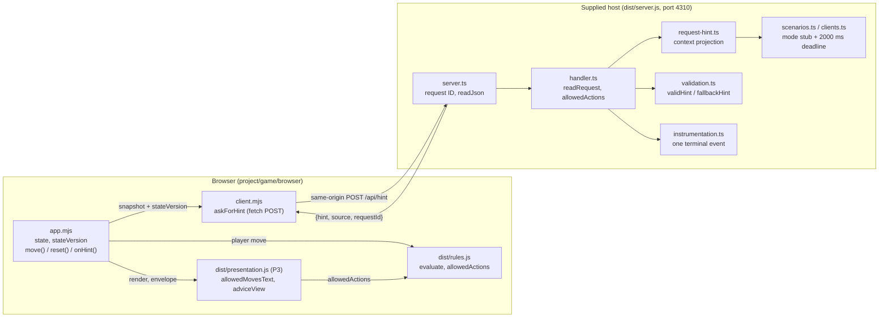

# Architecture: Reviewed Game with Contextual Hints

One Node process (`project/game/dist/server.js`, started by `lab.py serve`) serves the page and `POST /api/hint` on
the **same origin** (`http://127.0.0.1:4310`). The browser runs the game and applies moves locally with the rule
evaluator. The server only gives advice: it never changes the game.

## Request path

## One request, traced
1. `browser/app.mjs` `onHint`: saves `stateVersion`, copies the state (`structuredClone`), shows "Loading advice...",
   disables Hint.
2. `browser/client.mjs` `askForHint`: `POST /api/hint` with `{ boardId, state, stateVersion }`.
3. `src/server.ts` `createHost`: assigns `hint-xxxxxxxx`, parses the body.
4. `src/handler.ts` `handleHint`: `readRequest` checks the body; `allowedActions(board, state)` from `src/rules.ts`
   derives the permitted moves. If there are none, it returns `hint: null` with no model call (`no-action`).
5. `src/request-hint.ts` `requestHint`: sends only `{ boardId, position, movesRemaining }` + permitted actions to the
   mode client, wrapped in `withTimeout` (2000 ms).
6. `src/validation.ts`: `validHint` checks the shape and that the direction is in the permitted list; otherwise
   `fallbackHint` picks the first permitted move (N, E, S, W) or null.
7. `src/instrumentation.ts` `recordHint` → `server.ts` `eventSink`: one line `{requestId, latencyMs, outcome, fallback}`.
8. Back in `onHint`: `adviceView(board, snapshot, envelope, savedVersion, stateVersion)` from
   `src/presentation.ts` returns the advice line and the why line, or the stale message if the version changed.
   `finally` re-enables Hint. On a network error, `catch` shows "Advice unavailable; keep playing."

Nothing on this path calls `evaluate` or assigns `state`. Only `move()` and `reset()` in `app.mjs` do.

## The refactored boundary (P3)

| Function | Input | Output | Never |
|---|---|---|---|
| `allowedMovesText(board, state)` | board, current state | `"Allowed moves from (0,0): east, south."` or `"… none (status: won)."` | mutates input; decides legality itself |
| `adviceView(board, requested, envelope, savedVersion, currentVersion)` | board, the snapshot the hint was asked for, the envelope, both versions | `{ advice, why }` | shows a stale envelope; calls a move |

Why lines:
- `Permitted: east is an allowed move from (0,0) (east, south).`
- For a fallback, it adds `Fallback rule: the first allowed move in north, east, south, west order.`
- `Nothing to suggest: …` when no move is allowed.
- `Not permitted: …` if a direction outside the list ever arrived. The server already prevents this; the page still
  never calls such a move permitted.

The host serves only `dist/rules.js` and `dist/presentation.js` to the browser, so no host change was needed.

## Who owns what

| Part | File | Owner |
|---|---|---|
| Presentation boundary | `project/game/src/presentation.ts` | Owned (new) |
| Browser flow | `project/game/browser/app.mjs`, `index.html` | Supplied, changed (see `evidence/evidence.md`) |
| Browser client, styles | `project/game/browser/client.mjs`, `styles.css` | Supplied, unchanged |
| Own tests | `project/game/tests/presentation.test.mjs`, `hint-flow.test.mjs` | Owned (new) |
| Rules, adapter, validator, stubs, instrumentation, host | `project/game/src/*.ts` except `presentation.ts` | Supplied, unchanged |
| Fixed checks | `project/game/tests/evaluation.test.mjs` (24), `signals.test.mjs` (5) | Supplied, unchanged |
| Fixtures + runner | `project/game/fixtures/`, `scripts/verify-fixtures.mjs` | Supplied, unchanged |
| Harness | `lab.py`, `Makefile` | Supplied, unchanged |
| Records | `evidence/` | Owned |

## Outcomes in the terminal event

| Outcome | When | `fallback` |
|---|---|---|
| `model-success` | advice passed shape + legality | false |
| `validation-failure` | well-shaped but illegal, wrong shape, or malformed JSON | true |
| `timeout` | client did not settle within 2000 ms | true |
| `provider-failure` | client threw / HTTP error | true |
| `no-action` | game over, no permitted move, no client call | true |
